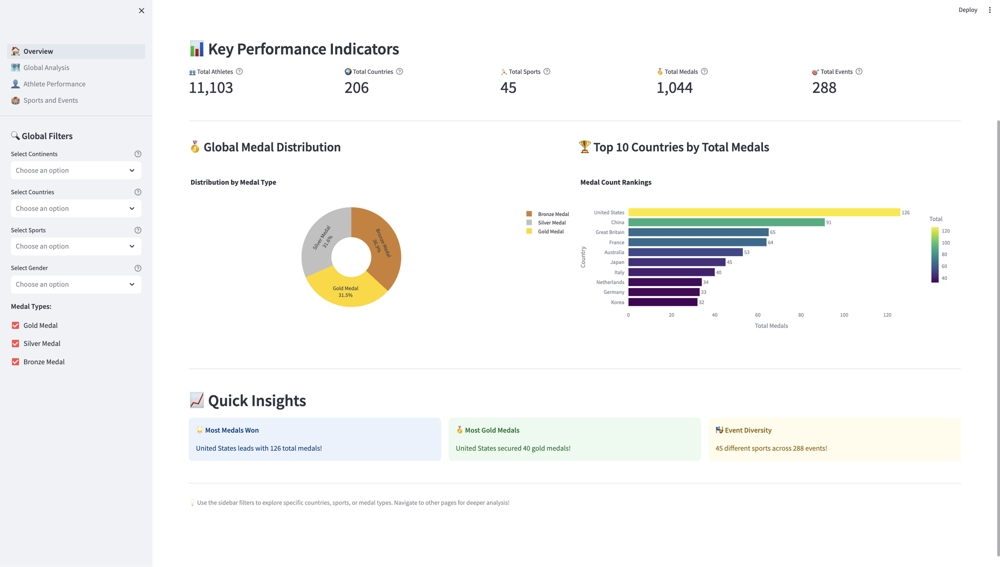
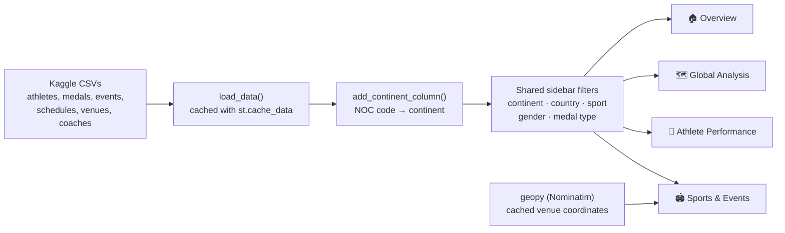
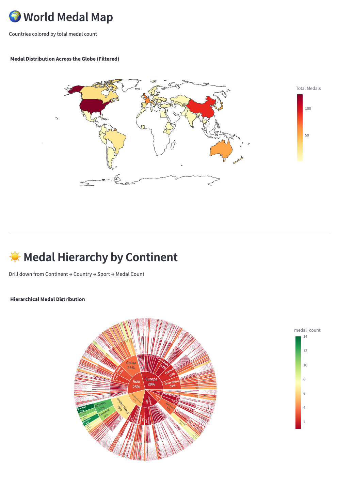
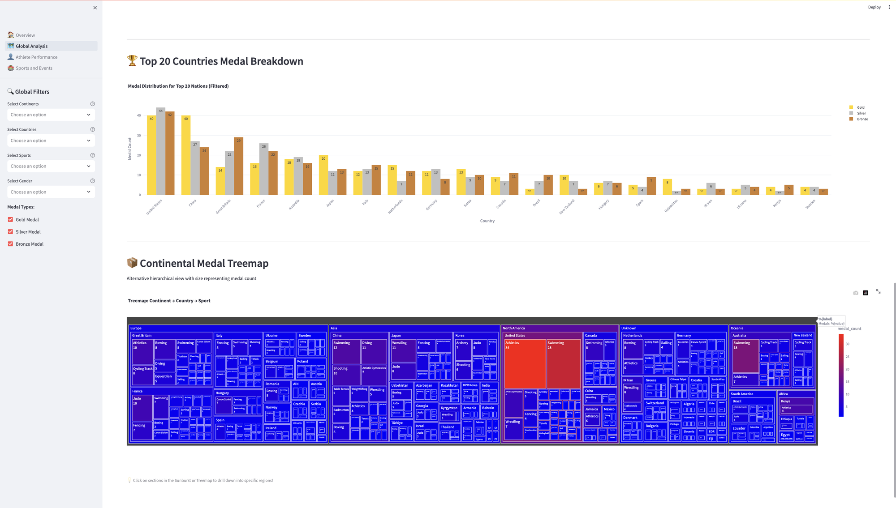
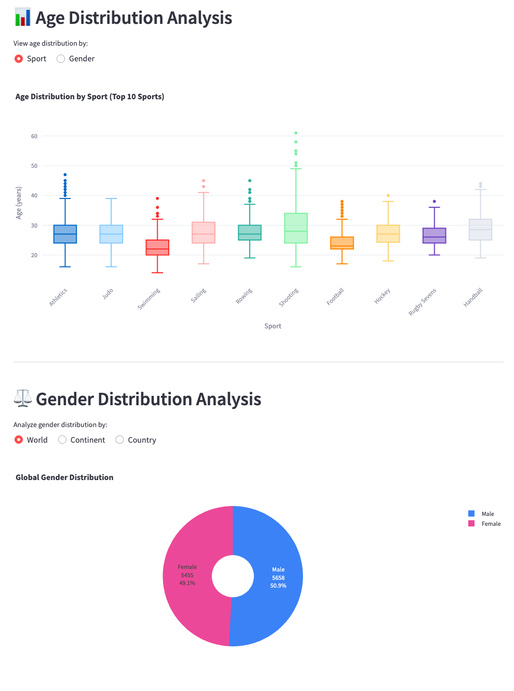
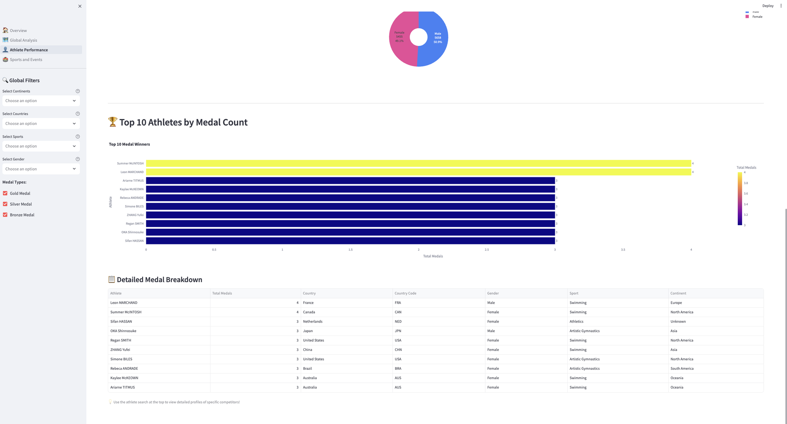
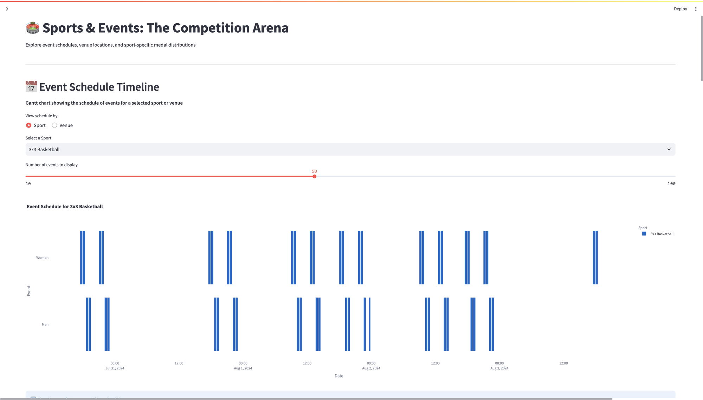
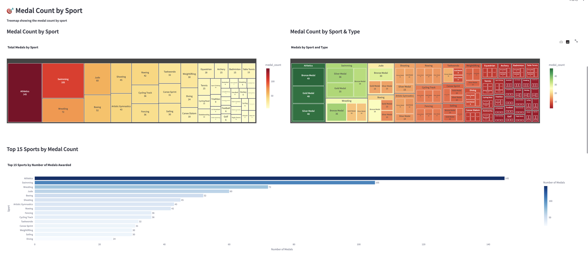
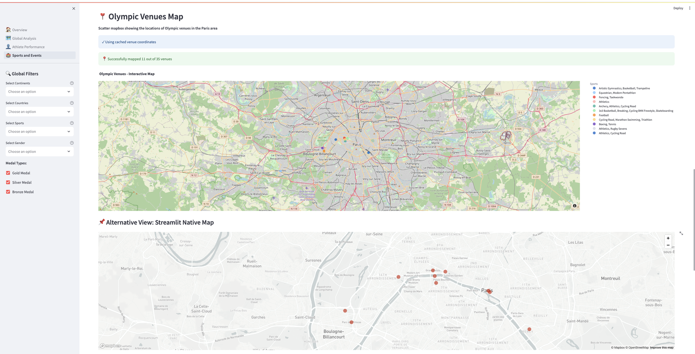
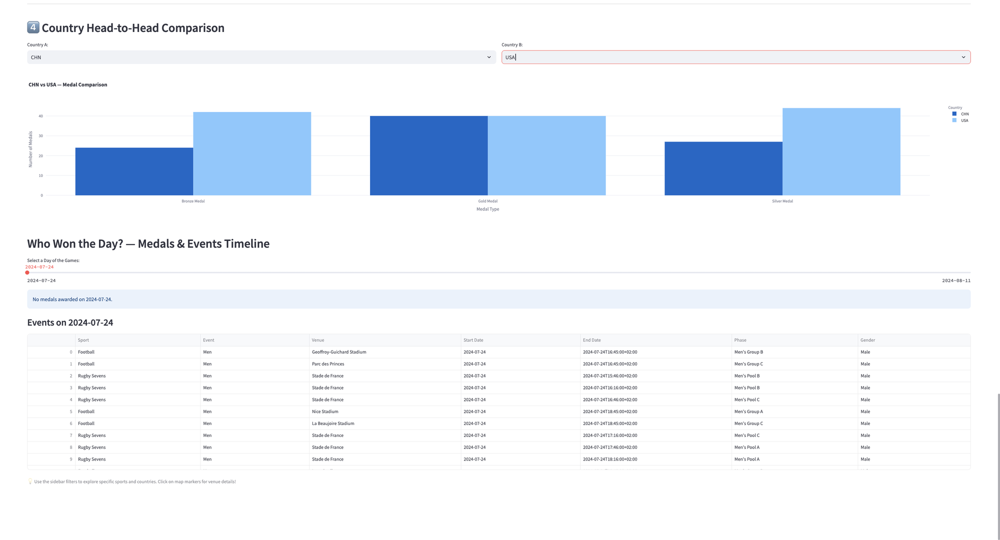

# Paris 2024 Olympics Dashboard

**An interactive Streamlit dashboard to explore the Paris 2024 Olympic Games: 11,103 athletes, 206 countries, 1,044 medals and 288 events, across four linked pages with shared filters.**



## Highlights

- **Four pages, one set of filters:** continent, country, sport, gender and medal type apply to every chart on every page.
- **18 interactive Plotly charts:** choropleth world map, sunburst and treemap drill-downs, event Gantt timelines, a venue map, age box plots and head-to-head comparisons.
- **Data enrichment:** country codes mapped to continents (including Olympic-only teams such as Refugee and Individual Neutral Athletes), and venues geocoded with geopy and cached.
- **Fast:** every CSV is loaded once and cached, so changing a filter only redraws the charts.

**Stack:** Python · Streamlit · Plotly · pandas · pycountry-convert · geopy

My part of this two-person team project: the **Athlete Performance** and **Sports & Events** pages, plus later fixes to the Overview and Athlete filters.

## How it works



## The pages

### 🏠 Overview
KPIs (athletes, countries, sports, medals, events), the medal split by type, the top 10 countries and quick insights such as the country with the most golds. *(screenshot above)*

### 🗺️ Global Analysis
A world map coloured by medal count, and a sunburst that drills down from continent to country, sport and medal.



Medals per continent, the top 20 countries by medal type, and a continent → country → sport treemap.



### 👤 Athlete Performance
- **Athlete profile:** search any athlete to see their country, sports, coach and medals.
- **Age distribution:** box plots by sport or by gender.
- **Gender split:** at world, continent or country level.



- **Top 10 medal winners**, with a detailed medal table.



### 🏟️ Sports & Events
- **Event schedule:** a Gantt timeline for a chosen sport or venue.



- **Medals by sport:** treemaps by sport and by medal type, and the top 15 sports.



- **Venue maps:** an interactive Plotly map of the Paris region and a zoomed Streamlit map of central Paris, with a table of venue coordinates. Only 11 of the 35 venues are geocoded automatically; the others can be added by hand to `data/venue_coordinates.csv`.



- **Country head-to-head:** pick two countries and compare their medals.
- **Who won the day?:** pick a date to see that day's medals and events.



## Run it

```bash
git clone https://github.com/Inesaini/olympics-dashboard
cd olympics-dashboard
pip install -r requirements.txt
streamlit run 1_🏠_Overview.py      # opens http://localhost:8501
```

The data is included in `data/`. Source: [Paris 2024 Olympic Summer Games](https://www.kaggle.com/datasets/piterfm/paris-2024-olympic-summer-games) on Kaggle.

## Project structure

| Path | Contents |
|---|---|
| `1_🏠_Overview.py` | Landing page |
| `pages/` | Global Analysis, Athlete Performance, Sports & Events |
| `utils.py` | Data loading and caching, continent mapping, shared sidebar filters |
| `data/` | Kaggle CSVs and cached venue coordinates |
| `screenshots/` | Images used in this README |

## About

Team project for the **Software Engineering for Data Science** course at ESI-SBA, supervised by Dr. Belkacem Khaldi. Team: Medjahri Mohammed Safouane and Aini Ines. Original team repository: [S4afou/olympics-dashboard](https://github.com/S4afou/olympics-dashboard).
